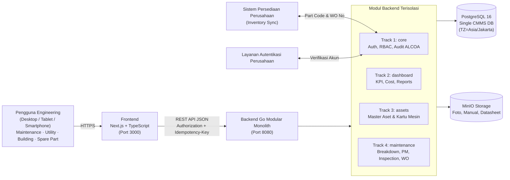

# Arsitektur Dasar CMMS — PT Bintang Toedjoe Site Pulogadung

Dokumen ini menjadi acuan teknis bersama untuk pengembangan **Computerized Maintenance Management System (CMMS)** Department Engineering (Divisi **Maintenance**, **Utility**, **Building Maintenance**, dan **Spare Part**).

---

## 1. Tech Stack & Target Infrastruktur (URS 2.1 – 2.2)

| Komponen | Teknologi | Alasan & Kesesuaian URS |
| :--- | :--- | :--- |
| **OS Server & Dev** | Linux (Ubuntu Server / Alpine Container) | Stabil, ringan untuk spesifikasi awal **4 vCPU / 8 GB RAM / SSD**, mendukung Docker & cron backup |
| **Containerization** | Docker & Docker Compose | Menjamin keseragaman environment antar laptop tim (IT, Teknik Industri, Teknik Elektro) & server |
| **Frontend** | Next.js (App Router) + TypeScript + Tailwind CSS | Sesuai acuan URS 2.2; responsif di desktop, tablet, dan smartphone; target load ≤ 3 detik |
| **Backend** | Go 1.26 (`pgx/v5/stdlib` + `minio-go/v7`, REST API JSON) | Sesuai acuan URS 2.2; performa tinggi, footprint memori kecil, isolasi folder per modul |
| **Database** | PostgreSQL 16 (Single Operational DB) | Sesuai URS 2.2 ("Ketiga modul menggunakan satu basis data operasional utama"), ACID, JSONB, trigger immutable |
| **Document Storage** | Silo (`pgsty/silo`, drop-in S3/MinIO-compatible) | Menyimpan foto kondisi aset, manual, datasheet, gambar teknis (`cmms-documents`); memisahkan `MINIO_ENDPOINT` (internal Docker) dan `MINIO_PUBLIC_URL` (browser/LAN) |
| **Zona Waktu** | `Asia/Jakarta` (WIB) | Wajib seragam di OS container, PostgreSQL (`PGTZ`), Go backend, dan formatting frontend (URS 2.1) |

---

## 2. Diagram Arsitektur Sistem



---

## 3. Struktur Modular & Isolasi File (Anti Merge-Conflict)

Setiap track pengembangan memiliki **folder kepemilikan eksklusif** di Backend, Frontend, dan Database Migration:

| Track | Branch | Backend (`backend/internal/modules/`) | Frontend (`frontend/src/features/`) | SQL Migration |
| :--- | :--- | :--- | :--- | :--- |
| **Track 1 — Core & GxP** | `feat/core-auth-gxp` | `core/` + `middleware/` + `database/` | `core/` + `app/admin/` | `001_core_auth_rbac_audit.sql` |
| **Track 2 — Modul 1 Dashboard** | `feat/module-1-dashboard-analytics` | `dashboard/` | `dashboard/` + `app/dashboard/` | `004_kpi_analytics_reporting.sql` |
| **Track 3 — Modul 2 Aset** | `feat/module-2-assets-machine-card` | `assets/` | `assets/` + `app/assets/` | `002_assets_machine_card.sql` |
| **Track 4 — Modul 3 Ops** | `feat/module-3-maintenance-ops` | `maintenance/` | `maintenance/` + `app/maintenance/` | `003_maintenance_operations.sql` |

> **Aturan Emas:** Jangan memodifikasi file di dalam folder track lain tanpa koordinasi di grup/PR. Jika perlu kontrak data bersama (mis. enum baru atau query lintas modul), diskusikan dengan **Gifari (Tech Lead)** untuk pembaruan di `shared/` dan `develop`.

---

## 4. Desain Kepatuhan GxP & ALCOA (URS Bab 2 & Bab 5)

| Prinsip ALCOA | Implementasi Teknis di Arsitektur Ini |
| :--- | :--- |
| **Attributable** | Setiap mutasi menyimpan `actor_id`, `actor_name`, `actor_role`, `created_at` di `audit_trails`. Pada `wo_shift_logs`, `performed_by` dipisahkan dari `recorded_by`. |
| **Legible** | API mengembalikan satuan eksplisit, timestamp `timestamp_wib`, serta membedakan `null` (`DATA_UNAVAILABLE`) dari nilai `0` yang sah. |
| **Contemporaneous** | Pemisahan `occurred_at` (waktu kejadian aktual) vs `recorded_at` (waktu input sistem), serta `operational_date` & `origin_shift` untuk pekerjaan lintas tengah malam / kontingensi BCP. |
| **Original** | Tabel `audit_trails` dilindungi trigger PostgreSQL `trg_audit_trails_immutable` (melarang `UPDATE`/`DELETE`). Aset tidak pernah dihapus (soft deactivation via `status = 'DEACTIVATED'`). Revisi laporan menyimpan `version` & `previous_export_id`. |
| **Accurate** | Optimistic locking (`version` column) mencegah *concurrent overwrite*; header `Idempotency-Key` + tabel `idempotency_keys` mencegah transaksi ganda saat retry; `external_tx_no` unik mencegah biaya material ganda saat rekonsiliasi. |

---

## 5. Kontrak REST API Standar

Semua endpoint berada di bawah prefix `/api/v1` dengan amplop JSON standar:

```json
{
  "success": true,
  "data": {},
  "meta": {
    "timestamp_wib": "2026-11-23T09:15:00+07:00",
    "data_stale": false
  }
}
```

Jika sinkronisasi persediaan atau cache analitik gagal (URS 2.2c & 4.1 BCP), backend tetap menyajikan data terakhir yang sah dengan `meta.data_stale = true` dan `meta.stale_message = "Data Belum Terkini — terakhir diperbarui ..."`.
