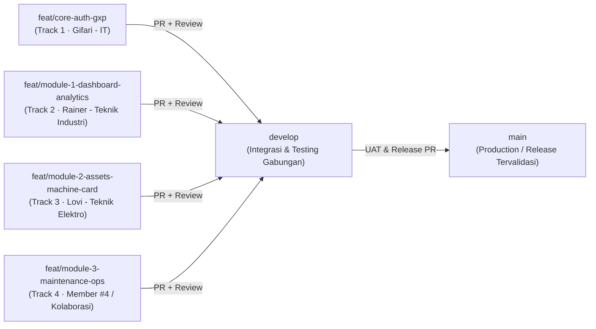

# Panduan Kerja Bareng, Pembagian Peran & Git Branching (Tim 4 Track)

Dokumen ini adalah **template kolaborasi tim** yang membagi pengembangan CMMS secara **modular ke dalam 4 branch kerja** berdasarkan keunggulan latar belakang tim:
- **Gifari** — Background **IT**
- **Rainer** — Background **Teknik Industri**
- **Lovi** — Background **Teknik Elektro**
- **Anggota #4 (TBD)** — Slot untuk anggota ke-4 *(disertai skenario kerja optimal selama tim masih beranggotakan 3 orang)*.

---

## 1. Struktur Git Branching



### Aturan Branch
1. **`main`**: Hanya berisi kode stabil & lulus uji (UAT / release). **Dilarang push langsung ke `main`.**
2. **`develop`**: Branch integrasi tempat 4 feature branch di-merge via **Pull Request (PR)**.
3. **4 Feature Branch Modular**:
   - `feat/core-auth-gxp`
   - `feat/module-1-dashboard-analytics`
   - `feat/module-2-assets-machine-card`
   - `feat/module-3-maintenance-ops`
4. Minimal **1 kali seminggu** (atau setelah kontrak API/migrasi berubah), tarik update terbaru dari `develop` ke branch masing-masing:
   ```bash
   git fetch origin
   git checkout feat/<branch-anda>
   git rebase origin/develop   # atau: git merge origin/develop
   ```

---

## 2. Pembagian Peran, Modul & Tanggung Jawab Detail

### Track 1 — Gifari (Background: IT)
- **Peran**: *Tech Lead, System Architect & Core Platform Engineer*
- **Branch**: `feat/core-auth-gxp`
- **Kepemilikan Kode**: `backend/internal/modules/core/`, `backend/internal/middleware/`, `backend/internal/database/`, `frontend/src/features/core/`, `frontend/src/app/admin/`, `infra/`, `docker-compose.yml`
- **Cakupan URS**: `1.1`, `1.2`, `1.3`, `1.4`, `2.2` (sync/freshness), `4.2` (Backup/Restore), `5.2` (Export engine), ALCOA `1.1–1.5`
- **Daftar Tugas Konkret**:
  1. **Autentikasi & Sesi (URS 1.1)**: Login JWT/cookie aman, pencatatan `auth_login_logs`, lockout sementara setelah 3x gagal, session timeout & re-auth.
  2. **RBAC Multi-Dimensi (URS 1.2)**: Middleware otorisasi berbasis `Role × Division × Area` + flag `can_approve`, `can_verify`, `can_export` + log `ACCESS_DENIED`.
  3. **Audit Trail & Idempotency (URS 1.3–1.4)**: Helper Go reusable `audit.Record(...)` yang dipanggil semua modul lain + middleware `Idempotency-Key` anti double-submit.
  4. **Koneksi PostgreSQL & MinIO**: Wiring `pgx/v5/stdlib`, upload/download dokumen teknis & foto ke MinIO dengan tautan ke `Asset ID` / `WO No`.
  5. **Integrasi Inventory & Infra Linux**: Adapter sinkronisasi `spare_parts` + flag `Data Belum Terkini`, script cron backup 4-jam (RPO ≤ 4 jam) & drill restore (RTO ≤ 8 jam).
  6. **Pendampingan Teknis**: Review PR dari Rainer & Lovi, menjaga kontrak API di `shared/`, serta membantu troubleshooting Go/Next.js/Git.

---

### Track 2 — Rainer (Background: Teknik Industri)
- **Peran**: *Industrial Engineering Lead, KPI/Analytics & Reporting Owner*
- **Branch**: `feat/module-1-dashboard-analytics`
- **Kepemilikan Kode**: `backend/internal/modules/dashboard/`, `frontend/src/features/dashboard/`, `frontend/src/app/dashboard/`, `database/migrations/004_kpi_analytics_reporting.sql`
- **Cakupan URS**: `2.1`, `2.2` (data quality flag), `2.3`, `2.4`, `2.5`, `2.6`, `2.7`, `2.8`, `2.9` (D), `5.1`, `5.2`, `5.3`, `5.4` (D), `5.5` (D)
- **Kenapa cocok dengan Teknik Industri**: Penguasaan *reliability engineering* (MTTR, MTBF, Availability), *maintenance cost accounting*, *inventory control* (theoretical requirement & reorder point), serta perancangan KPI & pelaporan manajerial.
- **Daftar Tugas Konkret**:
  1. **Spesifikasi & Validasi Rumus KPI (URS 2.7)**: Memastikan definisi resmi `MTTR` (perlakuan waiting time), `MTBF` (basis jam operasi), `Availability`, dan `PM Compliance` (kriteria tepat waktu) bersama Engineering Manager, lalu mendefinisikannya di `kpi_definitions` (mendukung versioning & target history).
  2. **Logika Downtime & Alokasi Lintas Shift (URS 2.4)**: Merancang query SQL/Go agar interval downtime yang bertumpuk pada aset sama hanya dihitung satu kali (*interval merging*) dan durasi lintas shift teralokasi proporsional per periode.
  3. **Analisis Biaya & Anggaran (URS 2.5 & 2.9)**: Perbandingan Planned vs Unplanned vs Breakdown Cost per aset/divisi/periode + perbandingan aktual vs `maintenance_budgets` (serta Cost-to-Output pada tahap lanjutan).
  4. **Analisis Kebutuhan Spare Part (URS 2.6)**: Perhitungan *Theoretical Requirement* (`qty standar × jumlah PM terjadwal`), deteksi material *high usage*, *slow moving*, dan risiko *stockout* vs `reorder_point`.
  5. **Dashboard Interaktif & Laporan Fleksibel (URS 2.1, 2.3, 2.8, 5.1–5.3)**: Filter gabungan (periode, divisi, area, line, kategori, shift, status), drill-down dari grafik ke daftar WO/Kartu Mesin, dan template ekspor PDF/Excel/CSV + revisi laporan.
  6. **Aturan Shift Reporting Otomatis (URS 5.4–5.5, Rank D)**: Merancang aturan tanggal operasional shift lintas tengah malam & status `Pending` vs `Nihil`.

---

### Track 3 — Lovi (Background: Teknik Elektro)
- **Peran**: *Asset Engineering Lead, Technical Specification & Inspection Standards Owner*
- **Branch**: `feat/module-2-assets-machine-card`
- **Kepemilikan Kode**: `backend/internal/modules/assets/`, `frontend/src/features/assets/`, `frontend/src/app/assets/`, `database/migrations/002_assets_machine_card.sql`
- **Cakupan URS**: `3.1`, `3.2`, `3.3`, `3.4`, `3.5`, `3.6` (+ *Domain Owner* standar parameter teknis inspeksi pada `4.6`)
- **Kenapa cocok dengan Teknik Elektro**: Memahami peralatan produksi, sistem utilitas (panel listrik, motor, chiller, kompresor, boiler, HVAC, PLC/instrumentasi), parameter ukur elektrikal/mekanikal (tegangan, arus, daya, suhu, vibrasi, tekanan), serta klasifikasi kekritisan aset di 4 divisi.
- **Daftar Tugas Konkret**:
  1. **Klasifikasi Master Aset & QR/Barcode (URS 3.1–3.2)**: Struktur kode aset unik & QR scan untuk 4 divisi (Maintenance, Utility, Building Maintenance, Spare Part), filter lokasi/kategori/criticality/status.
  2. **Skema Spesifikasi Mesin Dinamis (URS 3.3)**: Merancang template field JSONB `technical_specs` yang relevan per jenis aset (mesin produksi, sistem utilitas, fasilitas bangunan: daya, tegangan, kapasitas, dimensi, tahun, dll.) + manajemen lampiran manual/datasheet/gambar teknis.
  3. **Kartu Mesin & Posisi Komponen (URS 3.4 & 4.9c-d)**: Tampilan kronologis seluruh riwayat Breakdown, PM, dan Inspection terverifikasi per `Asset ID` + pelacakan riwayat penggantian komponen per posisi pemasangan & target penggantian berikutnya + fitur cetak PDF Kartu Mesin.
  4. **Workflow Perubahan Data Kritis & Optimistic Locking (URS 3.5)**: Alur persetujuan saat mengubah criticality/status/divisi/lokasi + mencegah overwrite bersamaan dengan kolom `version`.
  5. **Alur Penonaktifan Aset (URS 3.6)**: Validasi otomatis pengecekan WO terbuka & jadwal PM aktif sebelum penonaktifan, approval Manager Engineering untuk aset kritis, serta pengeluaran dari pilihan WO baru tanpa menghapus riwayat.
  6. **Standar Template Inspeksi (Cross-module Input untuk URS 4.6)**: Menyusun katalog parameter inspeksi, satuan, batas Normal/Peringatan/Kritis untuk aset elektrikal, utilitas, dan produksi.

---

### Track 4 — Anggota #4 (TBD) *(atau Strategi Pembagian untuk Tim 3 Orang)*
- **Peran**: *Maintenance Operations & Workflow Engineer*
- **Branch**: `feat/module-3-maintenance-ops`
- **Kepemilikan Kode**: `backend/internal/modules/maintenance/`, `frontend/src/features/maintenance/`, `frontend/src/app/maintenance/`, `database/migrations/003_maintenance_operations.sql`
- **Cakupan URS**: `4.1`, `4.2`, `4.3`, `4.4`, `4.5`, `4.6`, `4.7`, `4.8`, `4.9`, `4.10`, `4.11`, `4.12`
- **Daftar Tugas Konkret**:
  1. **Breakdown & Eskalasi K3 (URS 4.1–4.3)**: Pelaporan kerusakan + ringkasan Kartu Mesin, penetapan prioritas & eskalasi K3, pembuatan WO, penugasan ulang, riwayat prediksi selesai (`wo_eta_history`), diagnosis & pencatatan waktu (`waiting_minutes`, `active_repair_minutes`, `asset_ready_at`).
  2. **Preventive Maintenance (URS 4.4–4.5)**: Rencana PM tahunan berbasis kalender/jam operasi, riwayat reschedule, konfirmasi eksekusi PM menjadi WO, pengisian checklist & temuan abnormal.
  3. **Inspeksi Lapangan (URS 4.6–4.7)**: Eksekusi form inspeksi dengan validasi rentang nilai ukur otomatis (`Normal` / `Peringatan` / `Kritis`), pembuatan permintaan korektif / penautan ke breakdown.
  4. **Spare Part & Komponen pada WO (URS 4.8–4.9)**: Cek stok & lokasi gudang, status `WAITING_PART`, pencatatan `REQUEST` / `ISSUE` / `RETURN` terrekonsiliasi tanpa biaya ganda, update posisi komponen.
  5. **Serah-Terima Shift, Verifikasi, Rework & Penutupan WO (URS 4.10–4.12)**: Handover lintas shift pada WO yang sama, pengajuan `PENDING_VERIFICATION`, pengembalian `REWORK`, penutupan `CLOSED` atomik (update Kartu Mesin + jadwal PM berikutnya + konfirmasi status aset `ACTIVE`).

#### Bagaimana Jika Anggota #4 Belum Bergabung (Tim Aktif = 3 Orang)?
Branch `feat/module-3-maintenance-ops` **tetap dipisah** agar arsitektur bersih dan siap diserahkan kapan saja jika orang ke-4 masuk. Sementara tim masih 3 orang, bagi pekerjaan Track 4 berdasarkan kekuatan masing-masing:
- **Gifari (IT)**: State-machine Work Order (`OPEN` → `WAITING_PART` → `PENDING_VERIFICATION` → `REWORK` → `CLOSED`), transaksi atomik penutupan WO & integrasi transaksi spare part (`4.2`, `4.8`, `4.9`, `4.11`, `4.12`).
- **Lovi (Teknik Elektro)**: Alur Breakdown Reporting, Diagnosis/Root Cause, serta Eksekusi Inspeksi & Checklist Teknis (`4.1`, `4.3`, `4.6`, `4.7`).
- **Rainer (Teknik Industri)**: Rencana & Jadwal PM Tahunan, pencatatan waktu/downtime & Serah-Terima Lintas Shift (`4.4`, `4.5`, `4.10`).

---

## 3. Matriks RACI Kolaborasi

| Area Keputusan | Gifari (IT) | Rainer (T. Industri) | Lovi (T. Elektro) | Member #4 (Ops) |
| :--- | :---: | :---: | :---: | :---: |
| Arsitektur Sistem, Security, Auth/RBAC, Docker Linux | **A / R** | I | I | C |
| Skema Database & Kontrak REST API Bersama | **A / R** | C | C | C |
| Definisi KPI (MTTR/MTBF/PM), Cost & Reporting | C | **A / R** | C | I |
| Master Aset, Spesifikasi Teknis, Kartu Mesin, Standar Inspeksi | C | I | **A / R** | C |
| Alur Breakdown, PM, Inspeksi, WO & Verifikasi | C *(A jika 3 org)* | C *(R PM/Shift)* | C *(R BD/Insp)* | **R** |
| Pengujian GxP/ALCOA & UAT 4 Divisi | **A / R** | **R** | **R** | **R** |

*(R = Responsible, A = Accountable, C = Consulted, I = Informed)*

---

## 4. Roadmap Sprint Bertahap (Prioritas Rank `I` Wajib → Rank `D` Diinginkan)

| Fase | Target Utama | Output Terukur |
| :--- | :--- | :--- |
| **Sprint 0 (Minggu 1)** | Setup Linux + Docker + DB Migration + Kontrak API | Semua anggota bisa menjalankan `make up` dan mengakses halaman modul masing-masing |
| **Sprint 1 (Minggu 2–3)** | Pondasi Auth/RBAC/Audit (`1.1–1.4`) + Master Aset & Spesifikasi (`3.1–3.3`) + Kerangka KPI (`2.7`) | Login aman (lockout 3x), aset 4 divisi bisa didaftarkan, spesifikasi teknis & dokumen tersimpan |
| **Sprint 2 (Minggu 4–5)** | Alur Breakdown (`4.1–4.3`), PM (`4.4–4.5`), Inspeksi (`4.6–4.7`) + Pembaruan Aset/Deaktivasi (`3.5–3.6`) | Teknisi bisa mencatat Breakdown/PM/Inspeksi dan membuat WO |
| **Sprint 3 (Minggu 6–7)** | Spare Part WO (`4.8–4.9`), Shift Handover (`4.10`), Verifikasi/Rework/Close (`4.11–4.12`) → Kartu Mesin (`3.4`) | Penutupan WO otomatis memperbarui Kartu Mesin & jadwal PM berikutnya |
| **Sprint 4 (Minggu 8–9)** | Dashboard Analitik (`2.1–2.8`), Laporan & Ekspor PDF/Excel/CSV (`5.1–5.3`) | Supervisor & Manager bisa analisis MTTR/MTBF, downtime, biaya, spare part & ekspor laporan |
| **Sprint 5 (Minggu 10)** | Uji Beban (load ≤ 3 detik), Uji Backup/Restore (`4.2`), UAT 4 Divisi + Fitur Rank `D` (`2.9`, `5.4`, `5.5`) | Siap validasi QA & Engineering Manager PT Bintang Toedjoe Site Pulogadung |

---

## 5. Ritme Kerja Harian & Mingguan (Sync Tim)

- **Daily Standup (10–15 menit via chat/call)**:
  1. Kemarin menyelesaikan URS / task apa?
  2. Hari ini mengerjakan apa?
  3. Ada blocker teknis (Go/Next.js/SQL) atau butuh klarifikasi domain (Elektro/Industri/URS)?
- **Weekly Integration & Demo (Jumat, 45 menit)**:
  - Merge PR masing-masing branch ke `develop`.
  - Demo end-to-end (mis. Aset didaftarkan Lovi → Breakdown & WO ditutup → Kartu Mesin terupdate → MTTR & biaya muncul di Dashboard Rainer → Audit Trail tercatat di Core Gifari).
- **Definition of Done (DoD) setiap Task/PR**:
  1. Sesuai kriteria URS terkait dan prinsip ALCOA.
  2. `go test ./...` dan `npm run typecheck` lulus.
  3. Diuji di ukuran layar Desktop & Tablet/Mobile.
  4. Direview minimal 1 anggota tim (termasuk Gifari untuk perubahan schema/API).
